```
 ███╗   ██╗██╗ ██████╗ ██╗  ██╗████████╗███████╗██████╗ ███████╗██╗   ██╗
 ████╗  ██║██║██╔════╝ ██║  ██║╚══██╔══╝╚══███╔╝██╔══██╗██╔════╝██║   ██║
 ██╔██╗ ██║██║██║  ███╗███████║   ██║     ███╔╝ ██║  ██║█████╗  ██║   ██║
 ██║╚██╗██║██║██║   ██║██╔══██║   ██║    ███╔╝  ██║  ██║██╔══╝  ╚██╗ ██╔╝
 ██║ ╚████║██║╚██████╔╝██║  ██║   ██║   ███████╗██████╔╝███████╗ ╚████╔╝
 ╚═╝  ╚═══╝╚═╝ ╚═════╝ ╚═╝  ╚═╝   ╚═╝   ╚══════╝╚═════╝ ╚══════╝  ╚═══╝
 ─────────────────────────────────────────────────────────────────────────
  [ BBS NODE 01 ]       300 BAUD       SYSOP: YURI HARADA       EST. 1984
 ─────────────────────────────────────────────────────────────────────────
```

<p align="center">
  <a href="https://github.com/NightzDev"></a>
</p>

### `> DIR /W ARSENAL`

<p align="center">
  
  <br/>
  
  <br/>
  
  <br/>
  
</p>

### `> DIR /P WAREZ`

```
 ┌──────────────┬──────┬────────────────────────────────────────────────────┐
 │ FILENAME     │ LANG │ DESCRIPTION                                        │
 ├──────────────┼──────┼────────────────────────────────────────────────────┤
 │ MEMPROFILERX │ PY   │ real-time memory profiler. `memx run script.py`,   │
 │              │      │ no code changes. live on PyPI.                     │
 │ SCANME       │ PY   │ async recon toolkit. 8 modules, 34+ CMS prints,    │
 │              │      │ WAF detect, subdomain takeover, proxy/Tor, TUI.    │
 │ NEXUS4J      │ JAVA │ tree-walk interpreter with classes & inheritance.  │
 └──────────────┴──────┴────────────────────────────────────────────────────┘
   3 file(s)                                             ∞ bytes free
```

### `> TYPE UPLOADS.LOG`

```
 [2025-05-03]  UL >> AtsushiSakai/PythonRobotics ............... [MERGED]
               rewrote the internal sensors docs section with detailed
               descriptions and references.

 [2026-09-23]  UL >> openinframap/openinframap ................. [MERGED]
               translated the web frontend to Portuguese (Brazil):
               187/187 strings, 100% coverage.
```

<p align="center">
  <a href="https://github.com/AtsushiSakai/PythonRobotics/pull/1197"></a>
  <a href="https://github.com/openinframap/openinframap/commit/ad1fa602eee107360a89704bd16dbd46be9f1160"></a>
</p>

### `> UPLINK.LOG`

<p align="center">
  
</p>

```
 ─────────────────────────────────────────────────────────────────────────
  ALL TOOLS ON THIS BOARD ARE FOR AUTHORIZED TESTING AND RESEARCH ONLY.
  +++ATH0
  NO CARRIER
 ─────────────────────────────────────────────────────────────────────────
```
